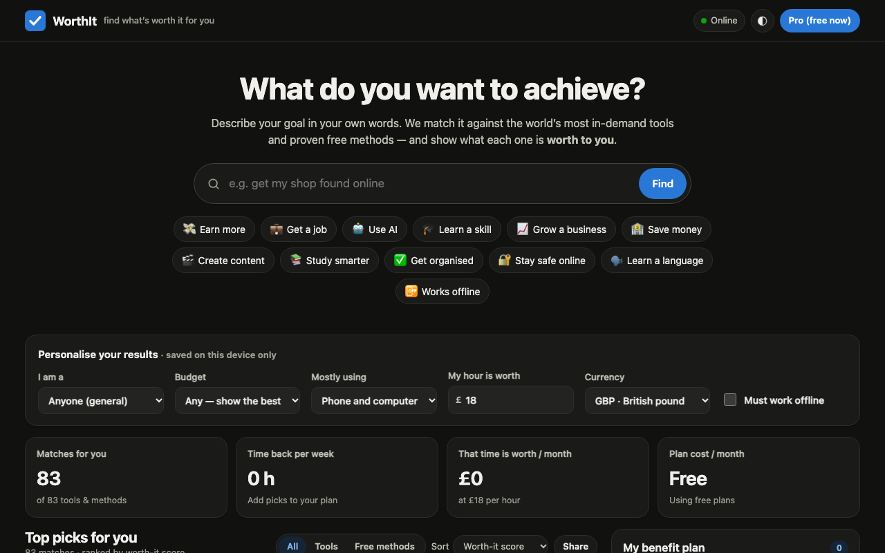

# WorthIt — find what’s worth it for you

**▶ Live demo: [https://ateetgogineni.github.io/worthit-dashboard/](https://ateetgogineni.github.io/worthit-dashboard/)**



A single-page dashboard. A visitor types a goal ("earn money from home", "pass my exams") and gets
the world’s most in-demand tools and free methods ranked by a **personal Worth-It score**, with
the time and money value *for them*, a break-even line, a benefit plan and a 7-day action plan.

- **Works offline**: everything (83 tools + methods, scoring, plans) is inside `index.html`.
- **Works online**: live concept explanations from Wikipedia, cached for offline use; questions
  asked offline are queued and answered automatically on reconnect.
- **No backend, no tracking**: profile and plan live in the visitor’s browser.

## Files
| File | Purpose |
|---|---|
| `index.html` | The whole app (HTML + CSS + JS + data). Works on its own, even opened as a file. |
| `sw.js` | Service worker — makes the hosted site load with no internet. |
| `manifest.webmanifest`, `icon*.png`, `icon.svg` | "Install app" support on phones and desktops. |
| `PROMPT.md` | The research and refined product prompt this build follows. |
| `scripts/auto-commit.sh` | Used by the Claude Code hooks to auto-commit changes. |

## Run locally
Double-click `index.html`, or serve the folder to test offline/install features:

```bash
python3 -m http.server 8765
```

## Go live
Upload the whole folder to any static host over **https** (Netlify Drop, GitHub Pages, Vercel,
Cloudflare Pages). No build step. After each update, bump `CACHE` in `sw.js` (e.g. `worthit-v1.0.1`)
so returning visitors get the new version.

## Charging a small fee
Edit the `CONFIG` block at the top of the `<script>` in `index.html`:

```js
pro: {
  enabled: true,                       // turn on free-tier limits
  priceLabel: "$2 / month",
  yearlyLabel: "or $15 / year",
  paymentUrl: "https://…",             // Stripe / Razorpay / Gumroad / Lemon Squeezy payment link
  freePlanLimit: 5,
  unlockHashes: ["<sha256 of a code>"] // codes you send buyers after payment
}
```

Make an unlock-code hash with:

```bash
printf 'MY-CODE-123' | shasum -a 256
```

Honest caveat: unlocking in the browser stops casual users, not determined ones. When revenue
justifies it, verify licence keys server-side (Lemon Squeezy and Gumroad both offer licence APIs).

## Updating the data
Each entry in the `KB` array has: name, link, goals, keywords, benefits per persona, free tier,
starting price (USD/month), estimated hours saved per week, ease, phone/offline support,
3 quick-start steps and alternatives. Prices and rankings are dated **November 2026** — review them
every few months and update `dataAsOf` in `CONFIG`.

## Auto-commit
Claude Code hooks (`.claude/settings.json`) run `scripts/auto-commit.sh` when Claude finishes a
turn (`Stop`) and when a session ends (`SessionEnd`), committing any changes in this repo.
Set your commit email once so commits are attributed properly:

```bash
git config user.email "you@example.com"
```
